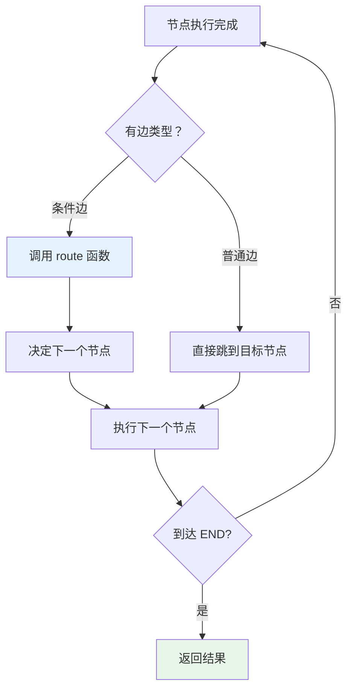
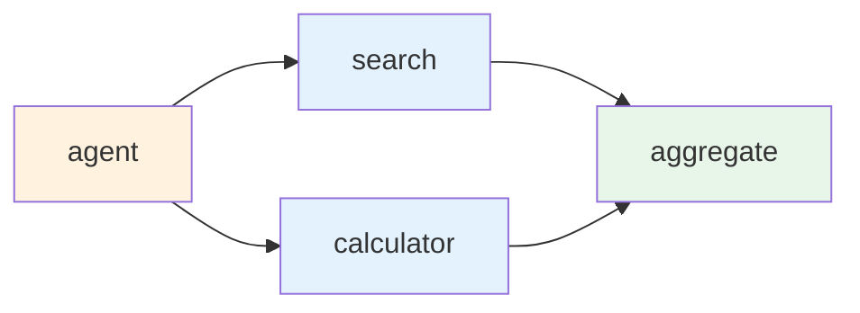

# LangGraph 底层原理：它是怎么把 LLM 变成一台状态机的

为什么同样是调用 LLM，用了 LangGraph 之后，AI 就能「想一步、停一步、判断一步」？就能在工具调用和 LLM 推理之间来回切换，还不会乱套？

答案就藏在它的状态机设计里。

---

## 01 先说说 LangChain 的老问题

LangChain 的早期架构是线性的——Chain。

```
用户输入→PromptTemplate→LLM→OutputParser→输出
```

这个模型干净利落，但有个致命弱点：**控制流是固定的**。

一旦你想实现「如果 LLM 觉得需要查数据库就查，不需要就跳过」，或者「出错了重试三次」，你会发现原来的 Chain 根本放不下这些逻辑。要么把判断逻辑硬编码在节点里，要么用 Python 的 if/else 在外层手动管流程——乱成一锅粥。

现实中的 Agent 场景根本不是线性的：

- 调工具 → 看结果 → 决定调下一个还是直接回答
- 生成草稿 → 自我审查 → 不行就重写
- 多轮对话 → 根据意图走不同分支

这些都需要**带状态的循环控制流**。这正是 LangGraph 解决的核心问题。


---

## 02 状态机是什么：用最简单的例子解释

状态机（State Machine）不是什么新概念。你手机的蓝牙就是个状态机：

```
[关闭]--打开-->[扫描中]--发现设备-->[配对中]--成功-->[已连接]
                                       |
                                       └--失败-->[扫描中]
```

三个核心要素：

```
┌─────────────────────────────────────────────┐
│              状态机三要素                     │
├──────────┬──────────────────────────────────┤
│  State   │ 当前的数据快照（系统处于什么情况）    │
│   Node   │ 执行动作，并更新 State              │
│   Edge   │ 决定下一步去哪个 Node               │
└──────────┴──────────────────────────────────┘
```

LangGraph 就是把这套机制套在了 LLM 上：

- **State** = 对话历史 + 工具结果 + 中间变量
- **Node** = LLM 调用 / 工具执行 / 业务逻辑
- **Edge** = 普通跳转 / 条件分支（Conditional Edge）

---

## 03 StateGraph 执行引擎：它的心脏长什么样

打开 LangGraph 的源码（Python 版 `langgraph/graph/state.py`，JS 版同理），你会看到 `StateGraph` 类维护了几个核心数据结构：

```
┌──────────────────────────────────────────────────┐
│              StateGraph 内部结构                  │
├─────────────────┬────────────────────────────────┤
│     nodes       │    Map<名称，函数>             │
│     edges       │    Map<from, to[]>            │
│ conditional_    │    Map<from, (state)=>节点名> │
│     edges       │                                │
│ channels/       │    每个状态字段的 Reducer      │
│     schema      │                                │
└─────────────────┴────────────────────────────────┘
```

当你调用 `graph.compile()` 时，它做了什么？

```
compile() 阶段
│
├─ 验证图结构（有没有孤立节点？有没有到 END 的路径？）
├─ 构建邻接表（预计算每个节点的后继）
├─ 初始化 Channels（每个状态字段注册 Reducer）
└─ 返回 CompiledGraph（可以 invoke/stream）
```

`compile()` 本质上是把你「描述的图」变成「可执行的调度器」。

---

## 04 一次完整执行：从 invoke 到节点运行的全流程

来看最简单的例子，一个单节点 LLM Agent：

```typescript
import { StateGraph, START, END } from "@langchain/langgraph";
import { Annotation } from "@langchain/langgraph";
import { ChatOpenAI } from "@langchain/openai";
import { HumanMessage } from "@langchain/core/messages";

// 1. 定义状态结构
const AgentState = Annotation.Root({
  messages: Annotation<HumanMessage[]>({
    reducer: (prev, next) => [...prev, ...next],
    default: () => [],
  }),
});

// 2. 初始化 LLM
const llm = new ChatOpenAI({ model: "gpt-4o-mini" });

// 3. 定义节点函数
async function callLLM(state: typeof AgentState.State) {
  const response = await llm.invoke(state.messages);
  return { messages: [response] };
}

// 4. 构建图
const graph = new StateGraph(AgentState).addNode("agent", callLLM).addEdge(START, "agent").addEdge("agent", END).compile();
```

执行流程：

```
invoke(input)
│
├─ 初始化 State = { messages: [input] }
├─ 从 START 节点出发
├─ 查找后继节点 → "agent"
├─ 执行 callLLM(state)
│  └─ LLM 返回 response
│  └─ 返回 { messages: [response] }
├─ Reducer 合并状态：prev=[input], next=[response] → [input, response]
├─ 查找后继节点 → END
└─ 返回最终 State
```


---

## 05 Reducer：状态更新的核心机制

每个状态字段都有一个 Reducer 函数，定义如何合并新旧值：

```typescript
// 三种常见 Reducer 写法

// 方式1：用内置 messagesStateReducer（追加消息）
const State1 = Annotation.Root({
  messages: Annotation<BaseMessage[]>({
    reducer: (prev, next) => [...prev, ...next],
  }),
});

// 方式2：覆盖（最新值覆盖旧值）
const State2 = Annotation.Root({
  step: Annotation<number>({
    reducer: (_, next) => next, // 直接替换
  }),
});

// 方式3：累加计数
const State3 = Annotation.Root({
  callCount: Annotation<number>({
    reducer: (prev, next) => prev + next,
    default: () => 0,
  }),
});
```

Reducer 的执行时机：

```text
节点返回 { key: value }
         │
         ▼
  对每个 key，找到对应 Reducer
  newState[key] = reducer(oldState[key], value)
         │
         ▼
  生成新 State 快照
  （旧 State 不变，不可变数据结构）
```

常见的 Reducer 模式：

- **追加模式**：`[...prev, ...next]` —— 适用于对话历史
- **覆盖模式**：`next` —— 适用于临时变量
- **最小值模式**：`Math.min(prev, next)` —— 适用于计数/阈值
- **自定义合并**：深度合并对象

---

## 06 图的调度器：它怎么决定下一步去哪

有两种边：

1. **普通边（Normal Edge）**：固定跳转

   ```typescript
   .addEdge("nodeA", "nodeB") // nodeA 执行完必去 nodeB
   ```

2. **条件边（Conditional Edge）**：根据状态动态选择
   ```typescript
   function route(state: State): "nodeB" | "nodeC" {
     if (state.needsTool) return "nodeB";
     return "nodeC";
   }
   .addConditionalEdges("nodeA", route)
   ```

调度器的工作流程：

```
当前节点执行完成
│
├─ 如果有条件边 → 调用 route 函数 → 决定下一个节点
├─ 如果有普通边 → 直接跳到目标节点
├─ 如果有多个后继 → 并行执行（见下一节）
└─ 如果到达 END → 返回结果
```



## 07 并行执行：Fan-out / Fan-in 模式

LangGraph 支持并行执行多个节点，典型场景是「同时调用多个工具」。

Fan-out：一个节点分发到多个并行节点  
Fan-in：多个并行节点汇聚到一个节点

```typescript
// Fan-out: 同时调用搜索和计算器
graph.addNode("search", callSearchTool).addNode("calculator", callCalculatorTool).addEdge("agent", "search").addEdge("agent", "calculator");

// Fan-in: 等待两者都完成后再聚合
graph.addNode("aggregate", aggregateResults).addEdge("search", "aggregate").addEdge("calculator", "aggregate");
```

并行执行时，调度器会：

1. 启动所有后继节点
2. 等待所有节点完成（或设置超时）
3. 将所有返回值合并到状态中



## 08 编译产物：CompiledGraph 里藏了什么

当你调用 `compile()` 后，得到的是一个 `CompiledGraph` 对象。它包含：

- **执行图（Execution Graph）**：预计算的邻接表
- **状态通道（State Channels）**：每个字段的 Reducer 注册
- **调度器（Scheduler）**：运行时决策逻辑
- **检查点（Checkpoints）**：支持持久化和恢复（可选）

```typescript
const compiled = graph.compile();

// 内部结构
compiled.nodes = { "agent": callLLM, "search": callSearchTool, ... };
compiled.edges = { START: ["agent"], "agent": ["search", "calculator"], ... };
compiled.channels = { "messages": MessageChannel, ... };
```

编译后的图可以直接 `invoke`、`stream` 或 `subscribe`：

```typescript
// 一次性执行
const result = await compiled.invoke({ messages: [input] });

// 流式输出
for await (const step of compiled.stream({ messages: [input] })) {
  console.log(step);
}
```

---

## 总结

LangGraph 的核心贡献在于：

1. **状态机抽象**：把 LLM 从「一次性推理」变成「可循环、可分支、可暂停」的状态机
2. **Reducer 机制**：安全、灵活的状态更新策略
3. **条件边**：动态决策，支持复杂 Agent 逻辑
4. **并行执行**：Fan-out / Fan-in 模式，提升工具调用效率
5. **编译优化**：预计算图结构，运行时高效调度

---
