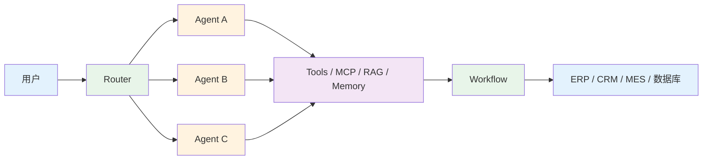
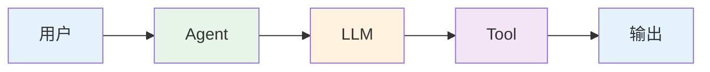
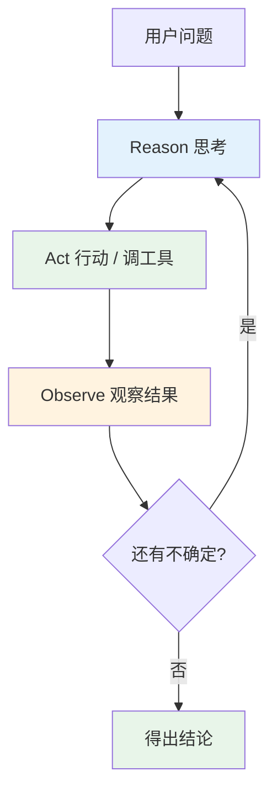
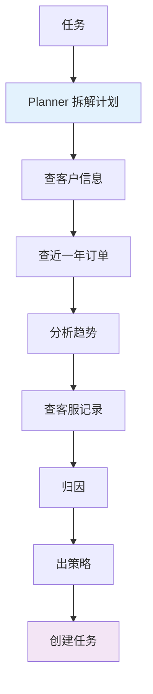
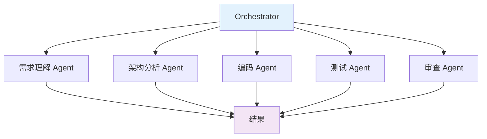
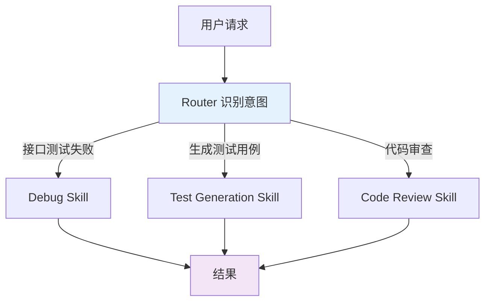
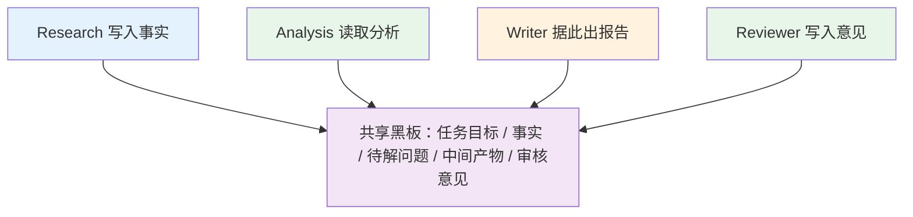
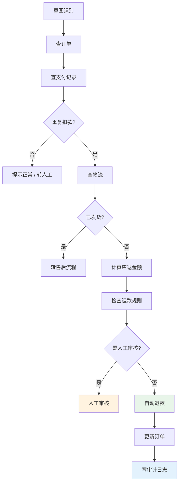
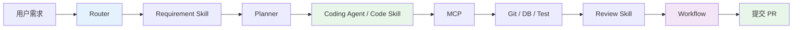

# 从单 Agent 到企业级 Workflow：讲透 Agent 的 7 种主流架构

看过不少 Agent 的文章，绕不开的几个词是：Single Agent、ReAct、Plan & Execute、Multi-Agent、Router、Skill、Workflow、Graph。

架构图也越画越复杂。最早的架构只是“用户 → LLM → 答案”；后来加上 Agent 和 Tools，再后来就变成了下面这样：

看到这种图，很容易冒出一个念头：是不是越复杂越先进？

我的答案是**不一定**。在客服问答场景上 Multi-Agent，多半是给自己添堵；反过来，一个跨系统、跨角色、带审批的业务流程，还让一个 LLM 自由发挥，早晚要出事。

所以真正该问的，不是“现在最先进的 Agent 架构是什么”，而是面对这个具体业务：**该给 Agent 多少自由度，又该加多少工程约束？**

下面按这个思路，把主流的 7 种架构过一遍。

## 01 问题变了：从“会不会答”到“怎么做完”

早期的 AI 应用很简单。用户问“什么是 RAG”，模型答；让它总结一篇文章，模型总结。

企业开始用 Agent 之后，需求变了。比如“帮我分析这个客户为什么最近采购量下降，然后制定跟进计划，并创建一个销售任务”。这一句话背后，AI 要查 CRM、订单、客服记录，要分析、要判断，再调用系统创建任务。

这就不是聊天机器人了，随之冒出一串问题：

- **谁决定下一步做什么？**
- **谁管理上下文和中间状态？**
- **失败了谁重试？权限谁控制？**
- **什么时候必须让人介入？**

Agent 架构，本质上就是在回答这些问题。

## 02 架构的本质，是管理不确定性

LLM 推理能力强，但天然不确定。同一个“订单为什么没发货”的问题，它这次可能先查订单再查库存，下次可能先查物流，发现没有单号再回头查订单。对探索型任务，这种自由是优势。

但生产系统里有些东西不能“自由”。比如“退款超过 5000 元必须人工审批”，这是业务规则，不是建议。AI 可以判断“这笔订单 6800 元，需要审批”，但要不要进审批流，最好由确定性的系统规则来控制。

这条原则会贯穿后面所有架构：

> **让 LLM 处理需要推理的部分，让工程系统处理需要确定性的部分。**

后面每一种架构，都是在这两者之间重新划线。

## 03 第一组：单个 Agent 怎么做决策

### 1. Single Agent

结构最简单：用户 → Agent → LLM → Tool → 输出。

它可能是最容易被低估的一种。“查一下今天的销售额”这种任务，理解问题、调用工具、返回结果，三步就完了，没必要拆成 Query Agent、Data Agent、Analysis Agent、Report Agent。

简单本身就是能力：调试容易，成本低，延迟低，权限和状态好管，出问题好定位。给“帮 User 增加一个 email 字段”这种需求，设计需求、架构、编码、测试、审查、部署六个 Agent，看着专业，其实是把一次函数调用变成了一场内部会议。

适合它的场景有：知识助手、FAQ、文档助手、编程 Copilot、简单查询、单工具调用。它开始不够用，是**任务变复杂、下一步该做什么不再显而易见**的时候。

### 2. ReAct

名字来自 Reason + Act，循环是：想一步，做一步，看结果，再想下一步。

现实里很多任务没法提前写死步骤。查“订单为什么没发货”，先查订单状态（已支付、未发货），再查库存（不足），再查补货计划（明天），最后得出结论：库存不足，预计明天补货。每一步都依赖上一步的返回，这正是 ReAct 擅长的。

代价是自由度太高，常见问题有：

- **工具调用过多**：本来两个 API 能搞定的事，调了十几个。
- **陷入循环**：A → B → A → B。
- **很难测试**：同一个任务每次路径不同。
- **成本不好估**：每一步都要过一次模型和上下文。

### 3. Plan & Execute

针对 ReAct 的不可控，一个自然的想法是：先把计划做出来，再执行。Planner 负责拆解，Executor 负责执行。

比如“分析客户采购下降原因并给出跟进方案”，可以先拆成下面几步：

好处是结构清楚、容易监控，失败时能定位到具体哪一步，而不是只收到一句“任务执行失败”。

前提是任务适合提前规划。像“帮我查一下这个客户最近有什么异常”，一开始根本不知道要查什么，硬做计划，多半做到一半发现计划本身就是错的。

所以 ReAct 和 Plan & Execute **不是替代关系**：前者适合动态探索，后者适合结构化任务。

## 04 第二组：多种能力怎么组织

任务类型变多、工具变多之后，问题从“怎么决策”变成“怎么组织”。

### 4. Multi-Agent

典型结构是一个 Orchestrator 调度多个 Agent，各自有独立的 Prompt、工具、上下文和权限。

不少文章把它理解为“任务太复杂，所以多搞几个 Agent”。我理解更准确的说法是：**它解决的是专业分工，而不是任务复杂度。**

比如企业内的 AI Coding：需求理解、架构分析、代码搜索、编码、测试、审查，各自需要的工具和知识差别很大。全塞给一个 Agent，Prompt 和工具列表会膨胀到失控，这时候拆分才有意义。

代价是协作复杂度。A 传给 B，B 传给 C，任何一环出错都会向后传导；一旦互相通信，关系很快就理不清。Agent 数量增加，复杂度不是线性增长的。所以拆分的前提是**分工真的存在**，而不是“Agent 越多越强”。

### 5. Router + Skill

我认为这是企业 AI Coding、内部 AI 平台里最值得关注、也最容易被忽略的一种。

Router 负责识别用户意图，再把任务交给对应的 Skill。用户说“帮我看看这个接口为什么测试失败”，走 Debug Skill；说“给这个接口生成测试用例”，走 Test Generation Skill。

Skill 可以理解为：一个工程师处理某类问题时遵循的标准做法。以代码审查为例，读需求、读规范、分析变更范围、检查依赖、检查异常处理、检查安全风险、跑测试、输出报告。这和只对模型说一句“帮我 Review 一下”完全不同：后者靠模型临场发挥，前者把方法固化成了可复用的能力。

企业里的任务其实高度“类型化”：需求分析、代码生成、Bug 修复、单元测试、Code Review、数据库分析……每类都有相对固定的方法。这时候与其拆一堆 Agent，不如做好分流，把每类任务的方法沉淀成 Skill。

和 Multi-Agent 的区别可以这样记：**Multi-Agent 关心“谁来做”，Router + Skill 关心“用哪套方法做”**。两者也能叠加，比如 Router 分流到 Coding Agent，再由它调用 Coding Skill。

### 6. Blackboard

Multi-Agent 再复杂一步，会遇到信息共享问题。Agent 两两直接通信，规模一大就变成蜘蛛网；Reviewer 发现问题要回头找 Analysis，Analysis 又要回头找 Data。

Blackboard 的思路，是不让 Agent 之间互相调用，而是建一个**共享状态空间**，里面放任务目标、已验证的事实、待解决的问题、中间产物、审核意见、任务状态。各个 Agent 围绕它读写：Research 写入事实，Analysis 读取后继续分析，Writer 据此出报告，不必把完整历史反复传一遍。

它也带来新问题：谁有权修改？多个 Agent 同时写怎么办？如何保证一致性？某个结论是谁写进去的？写错了怎么回滚？

所以 Blackboard 不是答案，它只是把问题从“Agent 之间怎么通信”换成了“Agent 怎么围绕共享状态协作”。对长任务、多角色的场景，这个换法通常更合适。

## 05 第三组：要上生产，就得可控

### 7. Graph / Workflow

前面几种解决的是怎么思考、怎么规划、怎么协作。到了生产环境，问题会变得很现实：怎么保证它按业务规则可靠地执行？

聊天可以错一次，企业流程往往不行。看一个例子，用户说：

> 我上周三买的那笔订单扣了两次款，一共 398 块，到现在货还没发。客服机器人让我等 48 小时，可我周五就要出差，赶不上就别发了，直接把多扣的钱退给我。

普通 LLM 大概会回：“很抱歉给您带来不便，建议您联系客服申请退款。”

但真要处理，得回答一堆问题：真的扣了两次吗？订单发货了吗？符合退款条件吗？该退多少？超没超出自动处理的权限？要不要人工审核？这些都不能靠语言生成来解决。一个合格的流程更像这样：

这时候重要的已经不是 Agent 会不会思考，而是它能不能在一个**确定、可追踪、可审计**的流程里行动。Graph / Workflow 的做法，就是把任务拆成明确的节点和状态，每个节点各自定义输入输出、可用工具、权限、校验、超时和重试策略。

Workflow 和 Graph 常一起出现。前者强调流程（审批、审核、执行、完成），后者强调节点、状态和条件，能表达分支、循环、并行和状态迁移。企业里通常是两者结合：用 Graph 描述状态和执行关系，用 Workflow 承载业务流程。

## 06 怎么选：从任务本身出发

落地时，别先问“要不要做 Multi-Agent”，可以按这几个问题逐个过：

| 问题                                         | 考虑                             |
| -------------------------------------------- | -------------------------------- |
| 任务很简单吗？问答、总结、单工具调用         | **Single Agent**，别为架构而架构 |
| 下一步依赖上一步结果，工具选择不确定？       | **ReAct**                        |
| 步骤能提前拆清楚？                           | **Plan & Execute**               |
| 有明确的专业分工，各有工具、知识、权限？     | **Multi-Agent**                  |
| 任务类型很多，每类都有成熟做法？             | **Router + Skill**               |
| 多个 Agent 要共同维护复杂状态？              | **Blackboard**                   |
| 涉及审批、金额、权限、发布、生产操作、审计？ | **Graph / Workflow**             |

## 07 真实系统往往是组合

前面为了讲清楚，把 7 种架构分开讲了。真实的企业系统很少只用一种，更常见的是叠加。比如一个 AI Coding 平台：

这里同时出现了 Router、Skill、Plan & Execute、Agent、MCP 和 Workflow，并不冲突，因为它们处在不同层面：有的管决策，有的管能力，有的管流程。

再往上一层，企业还需要一套把模型“管起来”的东西：权限、工具编排、上下文、记忆、错误恢复、人工审批、审计、可观测、成本控制。这一层可以统称为 **Harness**。一句话概括：**模型负责想，Harness 负责怎么安全地做。** 所以现在做 Agent，只研究 Prompt 已经不够了。

如果继续往企业深处走，还会碰到更底层的问题：AI 怎么理解“客户”“订单”“库存”这些概念、它们之间是什么关系、哪些数据能改、哪些动作要审批。这就引出企业语义层（Ontology），不过那是另一篇文章的话题了。

## 写在最后：别一上来就做“超级 Agent”

现在做 Agent 的团队，容易走两个极端。

一个是先做“万能 Agent”，挂上 100 个 Tool、50 个 Skill、20 套 Prompt，最后没人说得清一个任务为什么走了这条路径。

另一个是一上来就 Multi-Agent，一个简单任务也拆成 Planner、Research、Coder、Reviewer、Executor。结果是模型调用多了，系统复杂了，问题没有真正解决。

比较稳的路径反过来：

1. 先用 **Single Agent** 把任务做简单；
2. 遇到动态工具调用的问题，再引入 **ReAct**；
3. 步骤趋于固定，用 **Plan & Execute**；
4. 专业能力需要隔离，拆 Agent 或沉淀 **Skill**；
5. 任务类型变多，加 **Router**；
6. 共享状态越来越复杂，上 **Blackboard**；
7. 业务流程需要强控制，落到 **Workflow / Graph**。

> **架构应该被业务复杂度推着走，而不是被技术热点推着走。**

最后回到开头的问题。成熟的 Agent 设计，问的不是“最先进的架构是什么”，而是“这个业务需要多少智能，又需要多少确定性”。理解、推理、规划、判断、生成，交给 LLM；权限、流程、状态、校验、重试、回滚、审计，交给工程系统。中间靠 Router、Skill、Tool、MCP、Memory 和 Workflow 把两边接起来。

目标不是让 Agent 无所不能，而是让它在一个设计良好的系统里，知道什么时候自己决定，什么时候调工具，什么时候照 Skill 走，什么时候进入 Workflow，什么时候停下来等人。

这也是 Agent 从 Demo 走向企业系统的分水岭。
