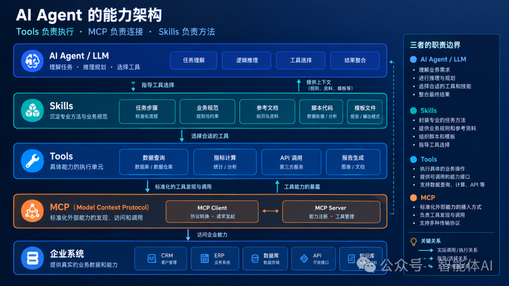
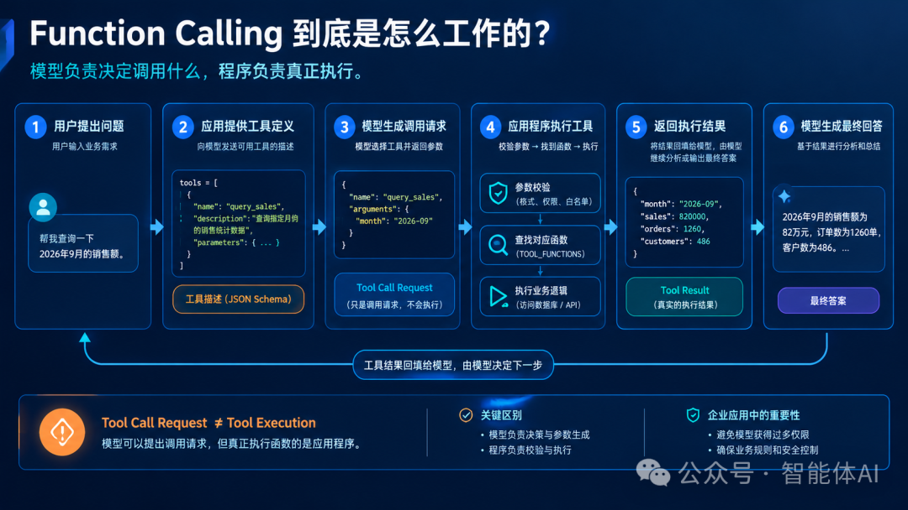
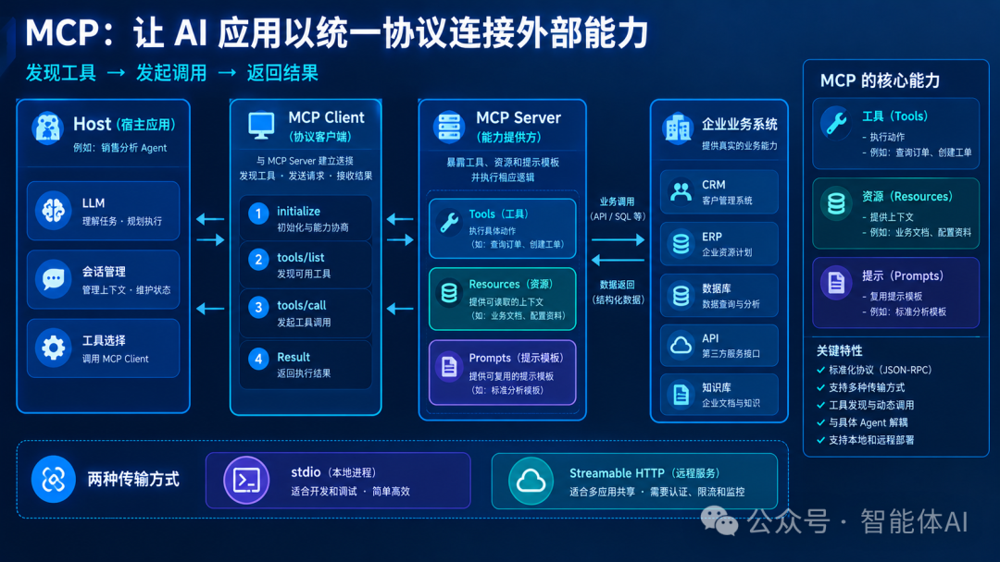
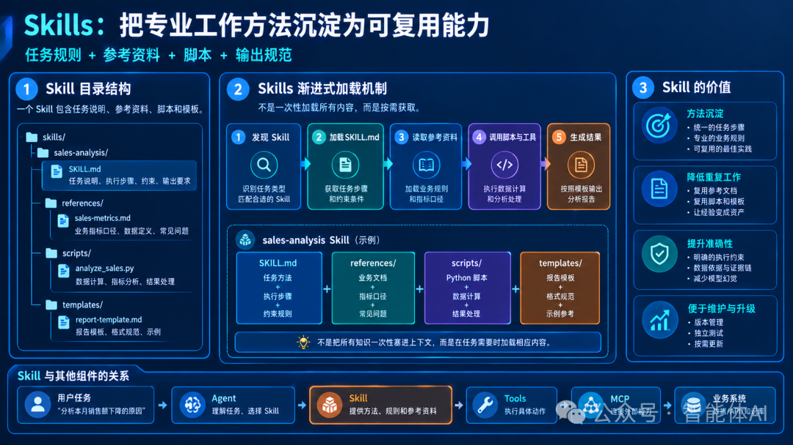
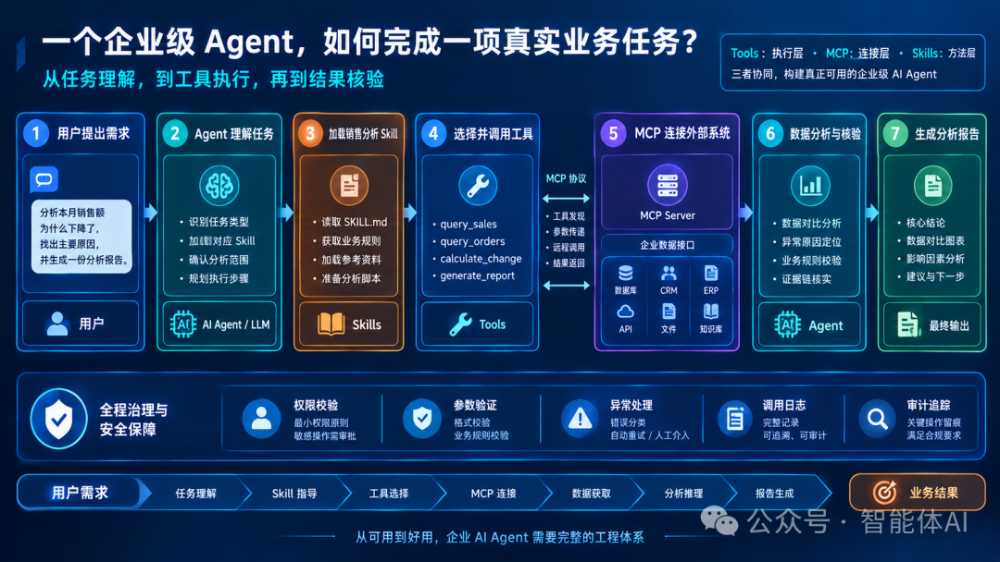

# AI Agent 的手脚、接口与操作手册：一次讲透 Tools、MCP 和 Skills

做企业级 Agent，最容易掉的坑往往不是“工具接得不够多”，而是 **Tools、MCP、Skills 三者的职责没有理顺**。结果常常是架构越堆越复杂，业务效果却原地踏步。

很多团队走的都是一条相似的路：先接一个大模型让它回答问题；再给它加几个工具，让它能查数据库、调 API；然后发现不同项目之间的工具没法复用，于是开始研究 MCP；等工具越来越多，又发现模型虽然什么都能调，却经常不知道该先做什么、后做什么，于是又引入 Skills。

走到这一步，一个关键问题就浮现出来：

> Tools、MCP、Skills 到底分别解决什么问题？它们之间是什么关系？一个真正能在企业里干活儿的 Agent，又该怎么把这三种能力组织起来？

如果这几个概念没理顺，很容易滑向两种结果：一种是架构越来越复杂，接了大量工具、搭了一堆 MCP Server，最后业务收益却寥寥；另一种是 Demo 很漂亮，但换个业务场景就要重新开发，接一个新系统就要改一堆代码，离真正的生产环境还很远。

这篇文章不打算只解释名词。我想从一个实际的开发任务出发，把这三者一步步串起来。我们就做一个 **企业销售分析 Agent**。用户只需要输入一句话：

> 帮我分析一下本月销售额为什么下降了，找出主要原因，并生成一份分析报告。

为了完成这个任务，Agent 要查询销售数据、比较不同月份的指标、分析异常情况，还要按照企业统一的分析规范组织结论。这件看似简单的事，恰好能把 Tools、MCP 和 Skills 的作用全部体现出来。



## 01 先别急着接工具，想清楚 Agent 到底缺什么

先看一个最简单的 Agent：用户在提问，Agent 把问题交给 LLM，LLM 直接生成文本回答。这个结构已经能完成很多工作，比如解释一个概念、总结一段文字、写一段 Python。可一旦用户要求它查询真实的销售数据，情况就完全不同了。

模型可能“知道”应该查数据库，但它不知道数据库地址、表结构、字段含义，也没有连接权限。就算把表结构塞进提示词，它也无法凭空读到最新数据。**这本质上不是推理能力的问题，而是缺了真实的执行能力。**

### 1. 给 Agent 增加 Tools

第一步很自然：给 Agent 提供工具。我们提供 `query_sales` 查询指定月份的销售额，提供 `calculate_growth` 计算销售变化率；要查客户就加客户查询工具，要出报告就加报告生成工具。

到这一步，Agent 已经从“只负责生成文本的系统”变成了“能调用外部能力的系统”。但马上会遇到第二个问题：

> 假设公司有 20 个 Agent，都要访问 CRM、ERP、数据库和知识库，难道每个 Agent 都要各自写一套连接代码吗？

显然不合理。这就引出第二个问题：**如何让不同的 AI 应用以统一的方式连接外部能力？** 这正是 MCP 要解决的事。

### 2. 有了连接，还缺一套专业的工作方法

假设工具全部接通，Agent 能查数据、拿客户信息、算增长率、生成报告。可是当用户说“分析一下销售额下降的原因”时，它真的知道怎么做吗？

它可能只对比了两个月的总销售额就直接下结论；可能忽略退货、订单取消、统计口径变化；甚至可能把相关性当成因果关系。问题在于：**工具只告诉了模型能做什么，并没有告诉它应该按什么专业方法把任务做完。**

所以要引入一种机制，把业务步骤、专业规则、参考文档和脚本组织起来，让 Agent 在执行时按需使用——这就是 Skills。

先记住三句话，后面的内容都从这三句话展开：

| 能力       | 解决什么问题                 |
| ---------- | ---------------------------- |
| **Tools**  | 具体动作如何执行             |
| **MCP**    | 外部能力如何通过统一协议连接 |
| **Skills** | 一类专业任务应该如何完成     |

这三者不是互相替代，而是分别解决不同层面的问题。

## 02 Tools：模型提出请求，程序负责执行

理解 Tools，最好从 Function Calling 讲起。

### 1. Function Calling 到底是什么

很多人第一次接触时会产生误解：模型调用了某个函数，是不是说明函数已经执行了？实际上，**模型通常只是生成了一个结构化的调用请求，真正执行函数的是应用程序。**

完整流程一般是：

1. 用户提出问题
2. 应用把工具定义（名称、描述、参数 Schema）发给模型
3. 模型判断需要用到工具，返回一段 JSON 调用请求
4. 应用程序拿到请求，校验参数，找到对应函数并真正执行
5. 程序把执行结果返回给模型
6. 模型基于结果继续分析，生成最终答案

以“帮我查询一下 2026 年 9 月的销售额”为例，模型返回的可能是：

```json
{
  "name": "query_sales",
  "arguments": {
    "month": "2026-09"
  }
}
```

这只是一段调用请求。应用收到后，还要找到 `query_sales` 对应的函数、校验参数、真正执行查询，再把结果（比如 `{"month":"2026-09","sales":820000}`）回填给模型，模型才能继续组织回答。

所以 Function Calling 并不是让模型直接执行任意代码，而是让模型按约定的接口提出请求，由应用程序决定是否执行。这个区别在企业应用中极其重要——**模型可以建议调用某个工具，但它不能因此自动获得该工具背后的全部权限。**



### 2. 工具的“描述”比想象中更重要

假设一个 Agent 同时拥有三个工具：`query_sales` 查销售统计、`query_orders` 查订单明细、`query_customers` 查客户信息。如果三个描述都只是“查询数据”，模型就很难判断什么时候该用哪个。

更好的描述应该说明工具的**业务用途、参数含义、数据范围与限制**。同样地，参数也要写清楚：月份只能用 `YYYY-MM` 格式就明确注明；某个参数只能取固定值就加枚举约束；某字段必填就设为 required。

这里要提醒一点：**JSON Schema 约束不等于安全校验。** 即使模型返回了符合 Schema 的参数，程序在执行前仍然应该再做一次验证。

### 3. 用代码实现一个最小的工具调用循环

用一个模拟数据表就能演示完整的工具调用过程。核心逻辑是：

- 定义一个 `query_sales(month)` 函数读取数据
- 把工具定义（name / description / parameters）传给模型
- 当模型返回 `tool_calls` 时，用 `TOOL_FUNCTIONS` 映射去执行对应函数，而不是让模型随意指定 Python 函数
- 把工具结果追加回对话，模型据此继续分析
- 设置最大调用次数，防止模型反复调用工具无法收敛

有几个细节值得记住：

| 要点                 | 说明                         |
| -------------------- | ---------------------------- |
| 模型拿到的是工具定义 | 不是直接执行函数的权限       |
| 程序维护函数白名单   | 不允许模型指定任意可执行对象 |
| 工具结果回填对话     | 模型据此继续推理             |
| 设置调用上限         | 防止死循环、控制成本         |

生产环境还应补上**参数白名单、异常分类、超时控制、调用审计和敏感数据过滤**，示例中的模拟数据也要替换成经过授权的数据库查询或业务 API。

到这里，我们已经实现了一个最小的工具调用 Agent。但它仍有一个问题：**工具定义和执行代码都写在 Agent 项目里。** 如果将来另一个 Agent 想复用这些能力，就得考虑工具接入的标准化——这就是下一节 MCP 的出场时机。

## 03 MCP：让工具不再绑定某一个 Agent

假设现在公司里有三个 Agent：销售分析 Agent 要查销售数据，客服 Agent 要查客户信息，运营 Agent 要查订单和商品数据。如果每个 Agent 都直连各业务系统，那么工具接入代码就会散落在不同项目里，业务接口一旦调整，每个项目都要跟着改。

MCP 的价值就在这里。

### 1. MCP 究竟解决什么问题

MCP（Model Context Protocol，模型上下文协议）是 AI 应用连接外部工具、数据和上下文的一套标准化协议。你可以把它理解成 **AI 应用与外部能力之间的“通用通信约定”**。

需要强调：MCP 不是数据库，不是大模型，也不是替你完成业务流程的 Agent 框架。它的核心职责是解决外部能力**如何被发现、如何被调用、结果如何返回**。

### 2. MCP 的三个角色

MCP 架构里有三个常见的概念：

- **Host（宿主应用）**：比如我们开发的销售分析 Agent，负责管理用户会话、模型调用、工具选择和整体流程。
- **Client（协议客户端）**：与 MCP Server 建立连接、查询可用能力、发送请求、接收结果。
- **Server（能力提供方）**：向客户端暴露工具、资源或提示模板，并执行相应逻辑。

关系是：Host 可以管理多个 Client，每个 Client 连接相应的 MCP Server。这样，销售查询能力就不必绑定在某个特定 Agent 的内部代码里。只要遵守协议，其他支持 MCP 的 Host 也能接入这个 Server。

当然这不意味着任何 Agent 都能无条件访问所有工具。**Server 仍要根据身份、权限和业务规则决定是否执行请求。**



### 3. MCP 不只有 Tools

MCP 还定义了其他类型的能力，需要区分清楚：

| 能力          | 作用                   | 例子               |
| ------------- | ---------------------- | ------------------ |
| **Tools**     | 执行动作               | 查询订单、创建工单 |
| **Resources** | 提供可读取的上下文资源 | 业务文档、配置资料 |
| **Prompts**   | 提供可复用的提示模板   | 标准分析模板       |

比如“查询某个订单”是 Tool；“读取一份销售指标口径文档”可以通过 Resource 暴露；“提供一套标准分析提示模板”则可以通过 Prompt 暴露。至于 Agent 是否使用、如何组合这些能力，仍取决于 Host 的实现。

### 4. 用 Python 写一个 MCP Server

真正动手时，我们并不需要手工处理 JSON-RPC 报文，也不用自己写 `tools/list` 和 `tools/call` 的分发逻辑——这些协议细节交给 MCP SDK 即可。用 `@mcp.tool()` 把普通 Python 函数注册为工具，SDK 会根据函数签名、类型注解和文档字符串自动生成工具描述。

例如一个 `query_sales(month)` 定义，SDK 就能告诉调用方“需要字符串参数 month”。但要注意：**类型注解不等于完整的业务校验**，真实项目还要验证月份格式、数据权限和查询范围。

这里如果用 `stdio` 传输方式，意味着 Server 通过标准输入/输出与客户端通信，适合本地子进程集成。**注意不要把调试日志打到标准输出**——stdout 承载的是协议消息，插日志可能导致通信失败，日志应写到 stderr 或专门的日志系统。

### 5. MCP 的调用链路发生了什么

跑一遍程序，背后发生的事情可以概括为：Client 启动 Server 子进程 → 双方初始化并协商能力 → Client 查询工具列表 → 发送 `query_sales` 调用请求 → Server 校验并执行函数 → 返回调用结果 → Client 接收结果交回 Host 决策。

这里最值得注意的不是代码多复杂，而是**客户端并没有直接 import `server.py` 里的 `query_sales` 函数**。它只知道 Server 提供了一个叫 `query_sales` 的工具、需要什么参数，调用时通过协议发出请求，由 Server 执行真正的业务逻辑。这就是“工具与调用方解耦”的关键。

三个边界一定要分清：

1. Client 负责通信，不代表它天然拥有业务权限。
2. Server 负责暴露能力，不替 Agent 决定整个任务流程。
3. 工具返回结果后，Host 才决定下一步是否继续调用。

### 6. 从本地 Server 走向企业服务

本地 `stdio` 很适合开发和调试。如果要让多个 Agent 或不同机器共享同一套工具服务，可以考虑 Streamable HTTP：部署后的 MCP Server 提供一个 HTTP 端点，客户端通过 URL 连接。

但要记住，远程部署不只是把 `stdio` 改成 HTTP，还要处理**认证、授权、网络隔离、请求超时、限流和服务监控**。对企业系统而言，MCP Server 更应该成为**经过治理的业务能力入口**，而不是一个绕过现有权限体系的通用代理。

## 04 让模型自动使用 MCP 工具

前面实现了 Server 和 Client，但还差一段工作：目前的 `client.py` 是我们自己决定调用哪个工具。真正的 Agent 应当能**根据用户的问题，由模型判断该用哪个工具，再由程序通过 MCP 执行**。

这一步其实就是把前面讲的 Function Calling 与 MCP 组合起来。注意，MCP 并不强制要求使用 Function Calling，这里用它是为了简单、直观。

### 1. 把 MCP 工具转换为模型可识别的定义

客户端通过 `list_tools()` 拿到 Server 的工具名称、描述和输入 Schema。在采用 OpenAI Chat Completions 工具格式时，可以做一个转换函数，把 `tool.inputSchema` 映射到 `function.parameters`。这一步通常叫**工具桥接或适配**。

要提醒的是，**MCP 的 Schema 不一定天然满足目标模型 API 的约束**。如果目标 API 对参数格式有更严格的要求，就需要在适配层做规范化与校验，不能假设所有 Schema 都能直接使用。

### 2. 把 MCP 调用封装成统一执行函数

再写一个适配函数，接收 session、tool_name 和 arguments，内部调用 `session.call_tool()`，并统一处理 `isError` 和结构化返回值。这样上层 Agent 不必了解每个工具背后的具体实现，只需要知道工具名称、参数和如何取结果。更完整的实现还应处理图片等不同类型的内容，并区分业务错误、协议错误和网络错误。

### 3. 把模型决策与 MCP 调用连接起来

整个 Agent 的执行循环可以概括为：连接 MCP Server → 读取工具列表 → 把工具定义交给模型 → 请求模型生成回答或工具调用 → 校验模型返回的工具名称与参数 → 通过 MCP Client 调用工具 → 把结果回填给模型 → 重复直到模型输出最终答案。

本质上的变化是：

> 原来是 `LLM → Tool Registry → Python 函数`；
> 现在变成 `LLM → Tool Registry → MCP Client → MCP Server`。

Agent 决定做什么，MCP 负责把请求送到相应的能力服务，Server 负责真正执行。这就是把“本地工具”升级为“可复用外部能力”的常见路径。

## 05 Skills：工具接通了，Agent 为什么还是做不好

现在回到销售分析场景。Agent 能查两个月数据、算变化率，我们用模拟数据算一下：9 月销售额 82 万，10 月 69 万，变化率约 −15.85%；订单数从 1260 降到 1080，下降约 14.29%。表面看两者同步下降，但即便如此，我们仍不能断言“销售额下降的唯一原因就是订单减少”——还有可能是客单价变化、商品结构变化、退款增加，或者统计口径变了。

要把问题分析清楚，Agent 还需要知道**应该按什么步骤分析、哪些结论可以得出、哪些还需要进一步证据**。这就是 Skills 的价值。

### 1. Skill 不是另一个 Tool

- **Tool**：一个可执行的动作，如 `query_sales`、`calculate_change`。
- **Skill**：一套可复用的任务方法，如 `sales-analysis`、`customer-churn-analysis`。

以销售分析 Skill 为例，它能告诉 Agent：确认分析月份和口径 → 查本月与上月数据 → 计算销售额、订单数、客户数变化 → 找出变化最明显的区域/产品/客户群 → 查相关数据验证原因 → 按统一模板生成报告并标注证据与不确定性。

这套方法很难用一个简单函数完整表达，它往往涉及多个工具、多个参考文件和一些可重复运行的脚本。**Skills 就是把这些内容组织起来的一种方式。**



### 2. 创建一个销售分析 Skill

一个 Skill 目录通常长这样：

```text
skills/
└── sales-analysis/
    ├── SKILL.md              # 入口文件：任务说明、执行步骤、约束
    ├── references/
    │   └── sales-metrics.md  # 业务口径、数据定义、常见问题
    ├── scripts/
    │   └── analyze_sales.py  # 数据计算、指标分析、结果处理
    └── templates/
        └── report-template.md# 报告模板、格式规范、示例
```

其中 `SKILL.md` 是入口文件，包含适用场景、执行步骤、分析约束和输出要求。例如约束里可以写：不得编造销售数据、不得把相关性直接表述为因果关系、缺少证据时要说明还需查询什么、口径不一致要先指出。

这里有个细节值得注意：**`SKILL.md` 并不是 MCP 协议的一部分。** 它是一种常见的文件型 Skill 组织方式，具体加载机制取决于 Agent 平台或运行时。有的框架会自动发现和加载 Skills，有的则需要开发者自己实现目录扫描、元数据读取和按需加载。所以，创建了一个 `SKILL.md` 并不意味着任何 Agent 都会自动使用它。

### 3. 把分析规则与计算代码分开

除了文字说明，Skill 还可以引用 Python 脚本。比如把变化率计算写进 `scripts/analyze_sales.py`，把数字运算交给经过测试的代码，而不是让模型在文字里自行完成所有计算。这样做有两个好处：

1. 结果可以重复计算和测试。
2. 模型可以把精力放在理解业务、识别异常、组织结论上。

但同样要提醒：**Skill 不能成为执行任意代码的理由**，脚本本身也要经过测试，并且只接受经过校验的输入。

### 4. 为什么要渐进式加载

假设一个 Agent 有 50 个 Skills。如果每次对话都把 50 个 Skill 的完整说明、所有参考文档和脚本塞进上下文，既浪费 Token，也容易让无关信息干扰当前任务。

更合理的做法是分层加载：用户提出销售分析需求时，Agent 先识别到 `sales-analysis`，加载 `SKILL.md` 理解任务步骤；需要确认统计口径时再读取 `references/sales-metrics.md`；需要算指标时再调用经过测试的 Python 脚本。这样技能的组就不再像“把一大段提示词不断追加进系统消息”，而是形成一套**可维护、可按需加载的任务知识结构**。

## 06 三者到底怎么配合

现在把前面的内容放到一起，我们已经有：

1. 两个 MCP 工具：查询销售数据、计算指标变化。
2. 一个 MCP Server：对外提供这些能力。
3. 一个 MCP Client：负责发现和调用工具。
4. 一个销售分析 Skill：负责指导分析流程。
5. 一个 Agent：负责理解目标、选择工具并综合结果。

完整的执行链路就串起来了。但最容易被忽略的是：**Skills 指导任务怎么做，Tools 提供实际动作，MCP 负责连接外部能力，而 Agent 本身还需要一个“运行时”来协调这些环节。**

三者组合起来，也不意味着 Agent 就一定会严格遵守每一条规则。对于关键业务流程，不能只靠提示词要求模型“不要跳过某个步骤”。比如某流程要求先完成数据校验、再允许生成正式报告，那就应该在代码或工作流状态机里设置明确的前置条件。同理，创建工单、修改客户等级、调整订单状态这类操作，**权限校验和业务规则应该在服务端执行**，而不是只写在 Skill 里让模型自行遵守。

一句话总结：

> **把专业方法交给 Skills，把确定性规则交给程序，把真实操作交给经过授权的工具，系统才会更可靠。**

## 07 企业级 Agent 不能只考虑功能，还要考虑治理

本地跑通 Demo，只能证明技术链路可行。真正进入企业环境，还要处理一系列工程问题。

### 1. 工具权限必须有明确边界

如果一个销售查询工具能执行任意 SQL，那么即使 Agent 只想查销售额，也可能接触其他敏感数据。所以生产环境应尽量采用受限的业务查询接口或参数化查询，而不是把数据库管理员权限直接交给 Agent。至少要考虑：最小权限原则、限制可查的表/字段/数据范围、对写操作设置独立授权、敏感操作实施审批、记录调用者与参数。

> 工具描述告诉模型“可以做什么”，真正决定“能不能做”的，仍是程序中的权限体系。

### 2. MCP Server 要有服务治理能力

当 MCP Server 从本地进程变成共享服务，就要面对并发、超时、网络故障和版本兼容等问题。比如 CRM 接口暂时不可用，Server 应返回明确错误，而不是让 Agent 一直等待；查询结果太大，服务端应支持分页、筛选或限制返回量；多个 Agent 并发调用，还需考虑并发限制和后端承载能力。

> 要记住：MCP 统一了通信协议，但不会自动替你解决所有分布式系统问题。

### 3. Skills 也需要版本管理与测试

如果销售分析 Skill 的规则发生变化，应该知道哪个版本改了步骤、改前后的输出有什么差别、哪些历史用例受影响、新规则是否引入了错误的业务口径。因此 Skills 最好与普通代码一样纳入版本管理。对重要技能，可以构建一套固定测试集，准备不同月份数据、缺失数据、零基数、异常值和口径不一致等场景，检查 Agent 是否能正确识别问题。

### 4. 不要忽略可观测性

一次完整的 Agent 任务，可能经过模型推理、多个工具调用、外部服务和脚本执行。如果结果不对却没有记录每一步发生了什么，就很难定位问题。建议至少记录：任务关联 ID、使用了哪个 Skill 及其版本、模型选择了哪些工具、每次工具调用的参数摘要、调用耗时与执行状态、错误类型与重试次数、结果所引用的数据来源。

日志涉及客户信息或业务数据时，还要做好脱敏与访问控制。对企业来说，**可追溯性不是锦上添花，而是定位问题、核验结果和持续改进的基础。**

## 08 什么时候才需要 Workflow 或 Multi-Agent

有了 Tools、MCP 和 Skills，是不是就不需要 Workflow 或 Multi-Agent 了？当然不是。这几个概念解决的是不同的问题。

- 任务很简单，比如查一个客户基本信息，一个 Agent 调一个工具就能完成，没必要再加编排层。
- 任务经常重复、但执行步骤需要专业指导，可以加一个 Skill 把方法和规则沉淀下来。
- 需要接入多个外部系统，可以通过 MCP 统一管理连接。
- 业务流程必须严格按固定顺序执行，或某一步失败后需要回滚、补偿，那 Workflow / 状态机通常更合适。
- 任务涉及多个独立领域，确实需要不同的上下文、专业能力或执行权限，再考虑拆分多个 Agent。

可以用下面这张表来判断：

| 业务需求                 | 更适合的机制          |
| ------------------------ | --------------------- |
| 执行一个明确动作         | **Tool**              |
| 统一接入外部能力         | **MCP**               |
| 复用一套专业任务方法     | **Skill**             |
| 强制约束执行顺序         | **Workflow / 状态机** |
| 多个领域的独立推理与协作 | **Multi-Agent**       |

没必要追求架构越复杂越好。对大多数企业项目，更稳妥的演进路线是：**先做好工具，再根据实际需求增加连接标准化、专业技能和确定性流程控制。** 只有当单个 Agent 已经出现明显的职责、上下文或协作瓶颈时，才值得进一步拆分。

## 写在最后：重要的是把事情做成

回头看开篇那个销售分析 Agent。一开始它只能根据问题生成文字；后来我们加了 Tools，让它能查数据、算指标；接着通过 MCP 把工具从 Agent 内部代码里解耦出来，让外部能力能按统一协议接入；最后用 Skills 把销售分析的方法、业务口径、执行步骤和输出规范沉淀下来。

这几步看起来只是多了几个技术组件，实际上对应的是 Agent 工程化过程中的三个重要问题：**能不能执行、能不能连接、能不能按专业方法完成任务。**

但这还不是终点。真正进入企业环境后，还要解决权限、业务规则、异常恢复、审计、可观测性和结果验证等问题：

- 工具能被调用，不等于调用一定正确。
- Skill 写得很完整，不等于模型每次都会严格遵守。
- MCP 能连接系统，也不等于连接之后就拥有了可靠的业务执行能力。

企业 Agent 的价值，最终取决于它**能否在明确的权限边界内，稳定地完成一项真实业务任务，并且让执行过程可追踪、结果可核验、问题可定位。**

所以，如果现在准备从零开发一个企业 Agent，我更建议按下面的顺序推进：

1. 先挑一个真实业务任务，把输入、输出和成功标准定义清楚。
2. 然后实现少量可靠的 Python Tools，让数据查询和业务操作稳定执行。
3. 当多个应用需要共享这些能力时，再把合适的工具封装成 MCP Server。
4. 当某一类任务需要反复执行时，再用 Skills 沉淀专业方法、参考资料和脚本。
5. 最后，根据业务风险和执行要求，增加 Workflow、权限治理、审计与自动化测试。

一步一步来，往往比一开始就搭一个庞大而复杂的 Agent 平台更容易得到真实结果。毕竟，**企业真正需要的，不是一个看起来无所不能的 AI，而是一个知道该做什么、能调用正确能力、按规则完成任务、出了问题能查清原因的系统。**


